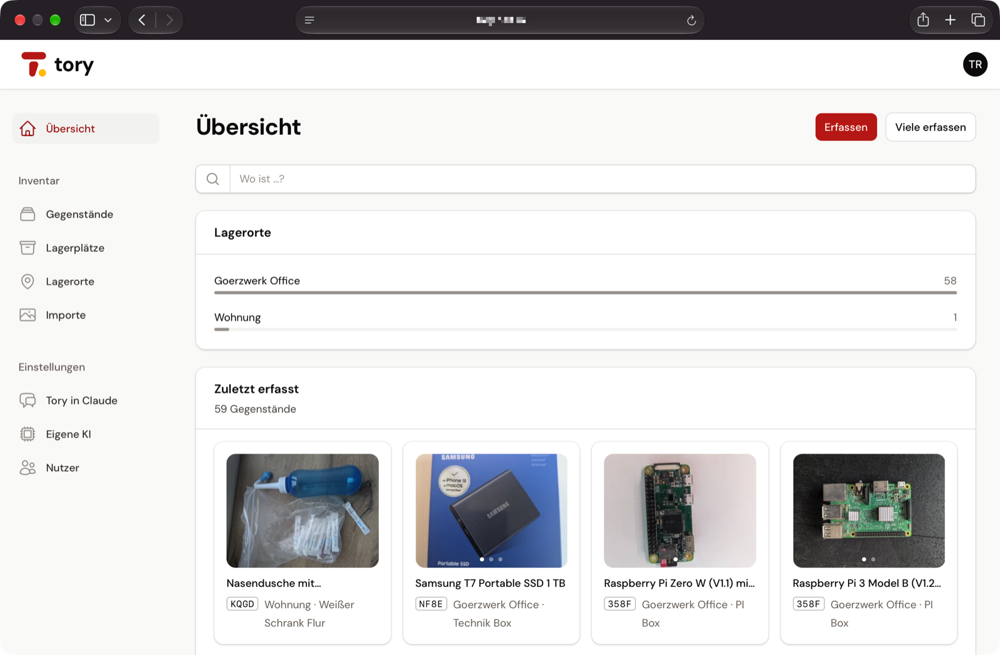

# Tory

A household inventory that answers one question: where is that thing?



You photograph an item, an AI model writes its title, description and search terms, and you put it on a spot such as "Regal 3, Fach 2" in the cellar. Later you search by keyword or by meaning and Tory tells you where the item lies. The interface comes in German and English; code and documentation are English. The vocabulary is defined in `CONTEXT.md`.

## What it does

- **Two languages.** Each user picks German or English for the interface in the user menu (without a choice the browser decides). Administrators set the household's content language on the page „Haushalt“; the AI writes titles, descriptions and search terms in it.
- **Photo imports.** "Erfassen" uploads 1 to 20 photos of one item; the extraction runs in the background and "Übernehmen" turns the result into an item on a spot. A bulk import takes many photos at once, groups them into items and lets you review the groups first.
- **Spots and locations.** A spot ("Lagerplatz") is the concrete place, a location ("Lagerort") groups spots. Every spot has a permanent four-character code and a page at `/spots/{code}`.
- **Labels.** Spot labels with a QR code are printed as a PDF sheet.
- **Search.** By keyword and by meaning (embeddings in pgvector, 1024 dimensions). Without an embedding provider the search still works by keyword.
- **Eigene KI.** Administrators set up AI providers (Ollama, Claude, OpenAI, Mistral) and pick one for object recognition and one for search. Nothing switches providers on its own.
- **Users.** One household per installation. An administrator invites users by link; there is no registration and no password reset.
- **REST API** under `/api/v1` with bearer tokens, documented at `/docs/api` (see `docs/api-handover.md`).
- **MCP server** at `/mcp` behind OAuth, so Claude can find items and spots and move items.

## Stack

Laravel 13 · Filament 5 · Livewire 4 · Laravel AI SDK · FrankenPHP (PHP 8.5) · Postgres 18 with pgvector

The Filament panel is the whole app and answers at `/`. Development happens entirely in Docker; you only need Docker Desktop (or compatible) on the host.

Each feature has a design document in `docs/superpowers/specs/` and a plan in `docs/superpowers/plans/`. `SECURITY.md` holds a security self-assessment and the contact for reporting a vulnerability. Running Tory in production and releasing it is described in `docs/production.md`.

## Requirements

For development you only need Docker with Compose; PHP, Composer and Node run in containers. The Compose stack brings the database along.

- **Postgres 18 with the pgvector extension.** Version 18 is required because a migration uses `uuidv7()`. The image `pgvector/pgvector:pg18-trixie` has both.
- **An AI provider for object recognition:** a local Ollama or an API key for Claude, OpenAI or Mistral. Without one, imports fail.
- **Optionally an embedding model with 1024 dimensions** for search by meaning (default `bge-m3` on Ollama). Without one, search works by keyword only.

The production image contains everything else. To run Tory without it you need PHP 8.5 with the extensions `pdo_pgsql`, `pgsql`, `intl`, `zip`, `gd`, `pcntl`, `bcmath` and `exif`, WeasyPrint for the spot labels, and Node 22 to build the assets. Released versions are on Docker Hub as `tredmann/tory` for amd64 and arm64.

## Getting started

```sh
git clone https://github.com/tredmann/tory.git && cd tory
docker compose up --build -d
```

On first start the `app` container copies `.env.example` to `.env`, generates `APP_KEY`, installs Composer dependencies and runs the migrations. The `vite` container installs npm dependencies and starts the dev server.

| Service | URL / port | What it runs |
|---|---|---|
| `app` | http://localhost:8000 | FrankenPHP (classic mode) + `queue:listen` + `schedule:work` under supervisord |
| `vite` | http://localhost:5173 | Vite dev server with HMR |
| `db` | `localhost:5432` (`tory` / `tory` / `secret`) | Postgres 18 with pgvector |

Mail uses the `log` driver: verification links appear in `storage/logs/laravel.log`.

## Create a user

There is no registration page. As long as Tory has no user at all, every page leads to `/setup`, where the first visitor creates the first administrator and is logged in. Whoever opens it first becomes administrator, so keep Tory unreachable from the internet until then. Once any user exists the page is gone for good.

If you cannot guarantee that, create the first user from the CLI instead, which closes the setup page from the start:

```sh
docker compose exec app php artisan make:filament-user --name=Admin --email=admin@example.com --password=secret
```

Users created from the CLI are not email-verified, and the panel requires verification. Either follow the verification link that is written to `storage/logs/laravel.log` on first login, or mark the user verified directly:

```sh
docker compose exec app php artisan tinker --execute='App\Models\User::firstWhere("email", "admin@example.com")->markEmailAsVerified();'
```

Then promote that user to administrator; further users are created by an administrator under "Nutzer" and open the invite link they are given:

```sh
docker compose exec app php artisan users:make-admin admin@example.com
```

## AI

`laravel/ai` is installed. AI is set up only in the panel, on **Eigene KI**; no AI key belongs in `.env`. The `App\Ai\Agents\Assistant` agent exists but has no UI yet.

Photos are imported at `/imports/create` ("Erfassen"): the upload is queued and `App\Ai\Agents\InventoryExtractor` turns the photos into a title and description in the household's content language, which appear on the import's page once the job has finished, so the queue worker must be running. Which AI does the work is set on the panel page **Eigene KI** (`/ai-providers`): "Provider anlegen" with name, vendor (Ollama, Claude, OpenAI, Mistral), API key or Ollama address, and model; "Testen" sends a small test photo; "Aktivieren" makes it the one used from the next extraction on. API keys are stored encrypted with `APP_KEY` and never shown again (only the last four characters), so changing `APP_KEY` makes stored keys unreadable and they must be entered again. The active provider cannot be deleted. Only administrators can see this page and export the keys.

There is no `.env` fallback: without an active provider, image recognition fails with a hint to set one up, and search runs on keywords only. For local development create an Ollama provider under **Eigene KI** with model `gemma4:e4b-mlx` and address `http://host.docker.internal:11434`, reached from the container via `host.docker.internal`, and a second one with `bge-m3` for search (1024 dimensions; run `ollama pull bge-m3` once).

## Everyday commands

```sh
docker compose exec app php artisan <command>      # artisan
docker compose exec app php artisan test           # Pest test suite (database tory_testing)
docker compose exec app ./vendor/bin/pint          # code style
docker compose exec app ./vendor/bin/phpstan analyse
docker compose exec app composer <command>
docker compose exec vite npm <command>             # npm (never on the host)
docker compose exec app supervisorctl status       # frankenphp / queue / scheduler
docker compose logs -f app                         # web, queue and scheduler output
docker compose exec db psql -U tory -d tory
```

The tests run on the Postgres database `tory_testing`, which a fresh volume creates on first start. For a volume that already existed, create it once with `docker compose exec db createdb -U tory tory_testing`.

Smoke-test the queue worker: `docker compose exec app php artisan tinker --execute="App\Jobs\PingLog::dispatch();"` and watch for `queue ok` in `storage/logs/laravel.log`.

## Laravel Boost

`.mcp.json` runs the Boost MCP server inside the container (`docker compose exec -T app php artisan boost:mcp`), so Claude Code picks it up from the project root with no host PHP. Guidelines live in `CLAUDE.md`, skills in `.claude/skills`. Refresh them with `docker compose exec app php artisan boost:install --guidelines --skills --mcp` (then `git checkout .mcp.json`, since Boost rewrites it for host PHP).

## License

Tory is released under the MIT license, see `LICENSE`.
